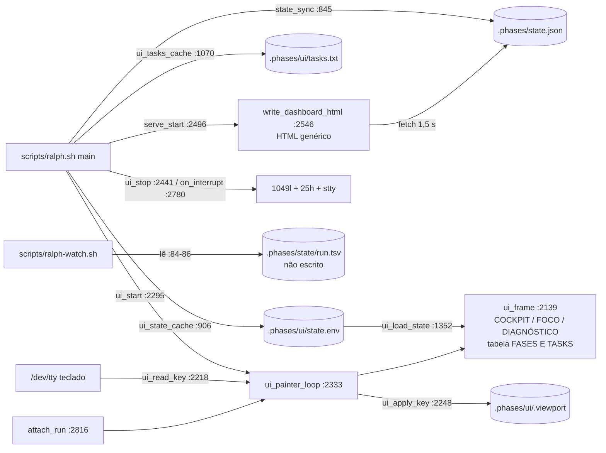
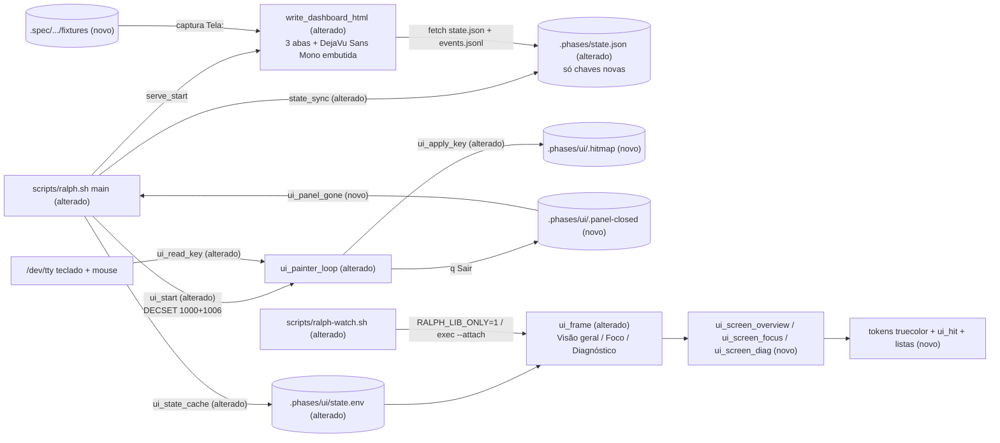

# Implementation Plan

> **Plano aprovado pelo desenvolvedor**: 15 tasks em 6 fases. Arquitetura em uma linha: `state_sync` publica campos aditivos, um único renderizador bash (`ui_frame`) desenha as três telas para run, `--attach` e `ralph-watch.sh`, o pintor ganha mouse SGR + mapa de cliques, e o `write_dashboard_html` é reescrito com as três abas lendo só `state.json`/`events.jsonl`. Decisões registradas em `## Decisões resolvidas`.

## Request Summary
- Objetivo: tornar o painel do `ralph.sh` (run, `--attach`, `ralph-watch.sh`) e o dashboard `--serve` fiéis aos artboards 01/02/03, com mouse (clique em aba, "f Seguir", "q Sair", fase, tarefa; roda sobre lista) e restauração completa do terminal em todo caminho de saída.
- Escopo in: três telas do terminal (UI-01..03), adaptação 100×24..144×40 (RF-15), campos aditivos no `state.json` (RF-14), mouse e seleção (RF-01..06, RF-11), "q Sair" que fecha só o painel (RF-03), restauração (RF-08), `ralph-watch.sh` = mesmo painel (RF-09), dashboard com três abas fiéis (UI-04..07, RF-10, RF-13), docs de Shift+arrastar.
- Escopo out: moldura de apresentação dos artboards, "Sair" no navegador, histórico novo de tarefas por fase, tabela FASES E TASKS, qualquer mudança em gate/ciclo/commit/repair/rescue/exit code, tema claro, abertura automática do navegador, placar corrido (fica byte a byte igual).
- Tier: complete
- Architecture references: `AGENTS.md` (única fonte; `docs/agents/` ausente no checkout, `.gitignore:12`). Regras preservadas: bash puro; observabilidade nunca muda veredito/exit code; `state.json`/`events.jsonl` só aditivos; `--serve` preso a `127.0.0.1` servindo um arquivo estático; `ralph-watch.sh` e `--attach` leitores puros; comportamento novo = caso nomeado em `scripts/test-ralph.sh` provado vermelho via `RALPH_BIN`; `scripts/check-shell.sh` verde.

## AS IS — Componentes impactados

Hoje o painel é pintado por `ui_frame` a partir do cache `state.env`, só com teclado; o `ralph-watch.sh` lê um contrato TSV que o `ralph.sh` não escreve mais; o dashboard é uma página genérica sem abas nem cliques. Todos os nós foram verificados no working tree (`scripts/ralph.sh`, 6493 linhas).

## TO BE — Componentes propostos

T01 produz as chaves novas do `state.json`/`state.env`; T02 as primitivas (tokens, `ui_hit`, listas); T03–T06 as três telas e a adaptação de tamanho; T07 mouse, mapa de cliques e seleção; T08 o "q Sair", o `.panel-closed` e a restauração em todo caminho; T09 o `RALPH_LIB_ONLY` e o `ralph-watch.sh` delegando ao mesmo `ui_frame`; T10 as fixtures de captura; T11–T14 o dashboard e a fonte embutida; T15 a documentação.

## Tasks

### T01 — Publicar os campos aditivos do estado (RF-14)
- **Files**: `scripts/ralph.sh` (`state_sync` :845, `ui_state_cache` :906, `ui_load_state` :1352, pontos de atribuição de `ST_FAILURE_*` :6033 e :6075, `gate2_tests_pass` :5095, início do ciclo de correção/repair/rescue), `scripts/test-ralph.sh`
- **Change**: acrescentar, sem tocar em nenhuma chave existente e com `schema` continuando `1`, as chaves: `failure {gate, cycle, headline, name, message, log}`; `test {scope, file, log}`; `tasks [{idx, title, subtitle, status}]` da fase corrente (status `done|declared|partial|running|pending`, mesma autoridade de `ui_tasks_cache`); `task_active` (índice, 0 = nenhuma); `correction {title}`; `previous_gates {"0".."3"}`; `display {status_word, status_tone, phases_done, phases_total, percent}` (percent = concluídas ÷ total × 100 truncado). Extração da falha num helper novo `ui_failure_digest <log>` que reusa `gate2_failure_ids` (:4555) para o `FAIL <nome>` e as marcas de `extract_failure_signature` (:4022) para a mensagem (`Expected…`, `Failed asserting…`); headline = `<nome>: <mensagem>` quando há FAIL, senão `gate_cause_summary`. `previous_gates` = snapshot de `ST_GATE0..3` antes do reset de cada novo ciclo/round. `correction.title` = "Conserto cirúrgico R/M — <gate>" / "Resgate R/M" / "Ciclo de correção C/M — <nome da falha>" / vazio. Subtítulo da tarefa = texto após o primeiro ` — ` ou `: ` do rótulo já sem `TNN —` e sem `(PLAN: TNN)`; sem separador → vazio. Espelhar os mesmos valores em `state.env` (terminal e navegador leem a mesma derivação). `events.jsonl` inalterado (CT-02).
- **Covers**: RF-14, RF-10, CT-01, CT-02
- **Tests**: `scripts/test-ralph.sh` — caso novo `state-additive`: roteiro `test-red-repairable` com log contendo `FAIL`; `state.json` traz `failure.name`/`failure.message`/`failure.headline` extraídos do log, `test.scope`, `tasks[]` e `display.percent` corretos; todas as chaves de CT-01 com o mesmo nome, tipo e valor de um run `ok` equivalente, `schema` = 1; JSON válido. Vermelho se uma chave antiga mudar/sumir ou a extração do FAIL falhar.
- **Risk**: Medium — contrato público; mitigado por teste de paridade de chaves.
- **Dependencies**: none

### T02 — Primitivas de desenho: tokens, fundo de célula, mapa de cliques, listas roláveis
- **Files**: `scripts/ralph.sh` (bloco da paleta :1217-1231, glifos :1209-1215, novos helpers perto de `ui_line` :1935)
- **Change**: paleta de tokens do SPEC em truecolor (`38;2`/`48;2`) quando `COLORTERM` ∈ {truecolor, 24bit}, fallback 256 cores mais próximo; helpers de linha com fundo de célula (`ui_fill_line <largura> <fundo> <texto plain> <texto colorido>`), faixa vertical à esquerda (ciano/vermelho), régua `#283545`, barra segmentada; glifos da SPEC (`✓ ▶ ● × · — › →`) como default das telas novas (D4), com `RALPH_UI_GLYPHS=ascii` mantido como recuo e uma coluna de folga por linha para glifo ambíguo; `ui_hit <ação> <col_ini> <col_fim>` que registra alvos relativos à seção e é deslocado por `ui_frame` para linha absoluta, gravado atômico (tmp+mv) em `.phases/ui/.hitmap` (`.hitmap.attach` no attach) no formato `linha|col_ini|col_fim|ação`; viewport por lista (`lista|start|total|budget`) em `.viewport`, com estado de rolagem por lista (`UI_SCROLL_<lista>`, -1 = auto) e seleção (`UI_SEL_PHASE`, `UI_SEL_TASK`, vazio = seguir).
- **Covers**: RNF-03, UI-01..03 (fundação), CT-04 (fundação)
- **Tests**: none — fiação de apresentação; os ramos que ela alimenta são cobertos pelos casos de T06, T07 e T08.
- **Risk**: Medium — `${#s}` conta caractere, terminal conta coluna; mitigado pela folga e pelo teste de geometria de T06.
- **Dependencies**: T01

### T03 — Tela "1 Visão geral" (UI-01) e barra de abas
- **Files**: `scripts/ralph.sh` (`ui_layout_header` :1963, `ui_layout_tabs` :1980, `ui_journey` :1992, `ui_cockpit_*` :2004-2066, `ui_sec_table` :1554 deixa de ser chamado pela Visão geral), `scripts/test-ralph.sh` (atualizar asserções de `ui-tty` :1619-1629, `ui-painter-exit` :2104-2110, `ui-locale-ranges` :3442-3443 que citam `FASES E TASKS`, `PROGRESSO`, `AO VIVO`, `RALPH / COCKPIT`, `1 Cockpit`)
- **Change**: função `ui_screen_overview` com as 7 regiões na ordem do artboard 01: cabeçalho `RALPH` (negrito ciano) · projeto · ENGINE (secundário) · `● <STATUS>` à direita na cor do `display.status_tone` + régua; quatro métricas (`TEMPO TOTAL`, `FASES CONCLUÍDAS NN / NN`, `CICLO ATUAL NN / NN`, `PROGRESSO / FASES NN%`) com valor em negrito; barra segmentada; jornada `✓/▶/· NN Título` com `ui_hit phase:N`; duas caixas com fundo `#101923` ("EM ANDAMENTO / FASE NN" com título negrito, `▶ Tarefa N: <título>` ciano com `ui_hit task:<fase>:<idx>`, `X verificadas / Y ativa / Z pendentes`, `› <atividade medida pelo pintor>`; "VALIDAÇÃO DA FASE" com G0..G3 e `ui_gate_words` :1941 na cor semântica); "ÚLTIMOS EVENTOS" (`HH:MM:SS  <frase>`, frase semântica, lista `events` rolável); régua + abas `1 Visão geral` / `2 Foco` / `3 Diagnóstico` à esquerda (ativa fundo `#233b48`, ciano negrito) e `f Seguir` / `q Sair` à direita, todas com `ui_hit`. A tabela FASES E TASKS sai da Visão geral. Campo sem valor = `—` na mesma posição. `RALPH_UI_LAYOUT=cockpit` continua aceito (compatibilidade de env).
- **Covers**: UI-01, RF-14 (campo vazio), RNF-03
- **Tests**: `scripts/test-ralph.sh` — asserções existentes reescritas para as regiões novas (a prova de vida do pintor passa a ser a linha `› …` da caixa EM ANDAMENTO); o caso de regiões é o de T06.
- **Risk**: Medium — reescreve asserções de 3 casos existentes (aprovado pelo desenvolvedor, D1).
- **Dependencies**: T02

Sem `Tela:`: o terminal não é rota HTTP; a captura do gate 3 só fotografa rota web com seletor CSS. A evidência visual do terminal é o dump de frame 144×40 do caso `ui-layouts` (T06) comparado com `artboards/01-visao-geral.png`.

### T04 — Tela "2 Foco" (UI-02) com seleção de fase/tarefa (RF-05, M6)
- **Files**: `scripts/ralph.sh` (substitui o ramo `focus` de `ui_frame` :2150-2155/:2165-2168)
- **Change**: `ui_screen_focus` com as 8 regiões do artboard 02: cabeçalho; `FASE NN / NN` ciano negrito · título · `TOTAL XmYs`; destaque com faixa ciano (`TAREFA NN / NN · <ESTADO>`, título negrito, subtítulo secundário ou linha em branco sem `—`, `› Editando <arquivo>` ciano); "CONFIRMAÇÃO INDEPENDENTE" (`X de Y tarefas verificadas` verde + `Atividade da sessão ≠ tarefa concluída`); caixa "TAREFAS DA FASE" à direita com fundo `#101923`, por tarefa `NN  Título` e palavra de estado (`verificada`, `em andamento`, `declarada`, `incompleta`, `pendente`), corrente/selecionada em ciano, lista rolável `tasks` com `ui_hit task:<fase>:<idx>`; pipeline `IMPLEMENTAÇÃO → TESTES → VERIFICAÇÃO → COMMIT` com etapa ativa `[ … ]`; linha `Ciclo N/M` + `Próximo: …`; abas. Com `UI_SEL_PHASE` definido e ≠ fase corrente: tarefas derivadas de `extract_task_labels` do arquivo daquela fase, todas `verificada` se a fase está `done`, todas `pendente` se futura; nenhum histórico novo gravado.
- **Covers**: UI-02, RF-05, RF-14 (subtítulo)
- **Tests**: `scripts/test-ralph.sh` — dentro de `ui-layouts` (T06): probe com `UI_SEL_PHASE=1` (fase done) mostra `FASE 01 / 03` e todas as tarefas da fase 1 `verificada`; `UI_SEL_PHASE=3` (futura) todas `pendente`; tarefa sem subtítulo deixa a linha em branco sem `—`. Vermelho se a derivação M6 ou a regra do subtítulo regredir.
- **Risk**: Low
- **Dependencies**: T03

Sem `Tela:` pelo mesmo motivo de T03; evidência = dump 144×40 contra `artboards/02-foco.png`.

### T05 — Tela "3 Diagnóstico" (UI-03) e estado sem falha (RF-16)
- **Files**: `scripts/ralph.sh` (substitui `ui_diagnostic_summary` :2077, `ui_diagnostic_log` :2113, `ui_event_lines` :2098)
- **Change**: `ui_screen_diag` com as 8 regiões do artboard 03: cabeçalho (`● CORRIGINDO` âmbar em correção); `FASE NN / NN  <título>` + `CICLO NN / NN` âmbar negrito; banner com faixa vermelha e fundo `#291c25` (`GN / <GATE> FALHARAM`, `failure.headline` negrito, `Escopo executado: <escopo> · <arquivo>`) — sem falha, faixa verde `● Nenhum gate falhou`; caixa "TENTATIVA ANTERIOR" com `previous_gates` (`✓ ● × ·` + frase); caixa "CORREÇÃO ATUAL" (`▶ <correction.title>` âmbar negrito, `Atividade: …`, `Depois: reavaliar os gates`); "LINHA DO TEMPO" (lista `timeline` rolável); caixa "SAÍDA DO TESTE" (`FAIL  <nome>` vermelho, mensagem, `Log: <failure.log>`; lista `testout` rolável lendo só logs sob `$LOG_DIR/`, mantendo a guarda de :2117); abas. Campos vazios = `—`, mesmas regiões e posições com e sem falha. `ui_clean_text` continua obrigatório para texto de log.
- **Covers**: UI-03, RF-16, RF-14
- **Tests**: `scripts/test-ralph.sh` — dentro de `ui-layouts` (T06): fixture de falha no G2 mostra `G2 / TESTES FALHARAM`, headline e `FAIL`; fixture sem falha mostra `● Nenhum gate falhou`, não contém `FALHARAM`, contém `LINHA DO TEMPO` e `—` nos campos vazios, com as mesmas 8 regiões na mesma ordem. Vermelho se o banner verde ou a estabilidade de regiões quebrar.
- **Risk**: Low
- **Dependencies**: T04

Sem `Tela:` pelo mesmo motivo de T03; evidência = dump 144×40 contra `artboards/03-diagnostico.png`.

### T06 — Adaptação de tamanho (RF-15) e caso de regiões por tela
- **Files**: `scripts/ralph.sh` (`ui_frame` :2139), `scripts/test-ralph.sh` (reescrever `ui-layouts` :3223 e `ui-box-width` :2967 para as telas novas)
- **Change**: `ui_frame` escolhe a tela, mede altura das regiões e aplica: ≥144×40 caixas lado a lado; entre 100×24 e 144×40 caixas empilhadas; se a altura não comporta, cai primeiro "ÚLTIMOS EVENTOS" (Visão geral), depois "LINHA DO TEMPO" e "SAÍDA DO TESTE" (Diagnóstico); abaixo de 100 colunas ou 24 linhas, só o aviso `aumente para 100×24`. Nunca mais linhas que `h-1` nem linhas mais largas que `w` (geometria atual preservada). Hitmap e viewports refletem só o que foi desenhado.
- **Covers**: RF-15, UI-01, UI-02, UI-03, RF-14 (campo vazio)
- **Tests**: `scripts/test-ralph.sh` — caso `ui-layouts` reescrito: (a) 144×40 as 7/8 regiões de cada tela na ordem dos artboards, sem `FASES E TASKS`; (b) 120×40 nenhuma região some; (c) 100×24 Visão geral sem `ÚLTIMOS EVENTOS` e Diagnóstico sem `LINHA DO TEMPO`/`SAÍDA DO TESTE`, demais presentes; (d) 99×24 e 100×23 só `aumente para 100×24`; (e) fixture com todos os campos novos vazios mostra `—` nas mesmas posições; geometria (≤ h-1 linhas, ≤ w colunas, sem ESC residual). Vermelho se a ordem de corte, o limiar ou a ordem de regiões mudar.
- **Risk**: Medium — maior reescrita de teste existente.
- **Dependencies**: T05

### T07 — Mouse SGR, mapa de cliques e seleção (RF-01, RF-02, RF-04, RF-05, RF-06, RF-07, RF-11)
- **Files**: `scripts/ralph.sh` (`ui_start` :2295, `ui_read_key` :2218, `ui_apply_key` :2248), `scripts/test-ralph.sh` (`ui-keys` :1968, `ui-non-tty` :1498)
- **Change**: em `ui_start`, somente dentro do ramo `UI_KEYS=1 && -r /dev/tty` (:2323), emitir `ESC[?1000h ESC[?1006h`; nenhum DECSET de mouse fora dele. `ui_read_key` aceita CSI `<b;x;y(M|m)` lendo byte a byte até 16 bytes; sequência truncada/desconhecida é descartada sem efeito. `ui_apply_key` resolve `M` (press) contra o `.hitmap` do último frame: `tab:1..3` = mesmo efeito de `1/2/3`; `follow` = mesmo efeito de `f/a` (zera seleção e todas as rolagens); `phase:N` e `task:F:I` abrem Foco com `UI_SEL_PHASE/UI_SEL_TASK` e suspendem o seguir; botões 64/65 (roda, ignorando bits de modificador) rolam 1 linha a lista cujo retângulo contém o ponteiro; fora de lista, nada. Teclas atuais (`1/2/3`, setas, `j/k`, PgUp/PgDn, espaço, `g/G`, Home/End, `a/f`) passam a agir sobre a lista primária da tela (Visão geral: eventos; Foco: tarefas; Diagnóstico: saída do teste) com o mesmo efeito de hoje. Release (`m`) ignorado.
- **Covers**: RF-01, RF-02, RF-04, RF-05, RF-06, RF-07, RF-11, CT-04, RNF-01
- **Tests**: `scripts/test-ralph.sh` — `ui-keys` estendido (pty via `script`, attach sobre fixture de 12 tarefas): clique SGR em "2 Foco" mostra a tela Foco com a aba ativa; roda para baixo sobre "TAREFAS DA FASE" move a primeira visível de 01 para 02, roda sobre o cabeçalho não muda nada; clique em "✓ 01" mostra `FASE 01 / NN` e o frame seguinte não troca a seleção; clique em "f Seguir" volta à fase corrente; sequência truncada seguida de `↓` rola uma linha e o frame não contém os bytes da sequência; teclas atuais reproduzem o efeito antigo na lista primária. `ui-non-tty` estendido: saída redirecionada não contém `ESC[?1000h`, `ESC[?1002h`, `ESC[?1003h`, `ESC[?1006h`, `ESC[?1015h`, e `RALPH_UI_KEYS=0` no pty também não. Vermelho se o mapeamento, a regra "fora de lista" ou o descarte de lixo regredirem.
- **Risk**: High — entrada do tty e coluna reportada pelo terminal com glifos ambíguos.
- **Dependencies**: T06

### T08 — "q Sair" e restauração em todo caminho de saída (RF-03, RF-08, RF-12, RNF-06)
- **Files**: `scripts/ralph.sh` (`ui_apply_key`, `ui_painter_loop` :2333, `ui_stop` :2441, `cleanup_ui` :2768, `on_interrupt` :2780, `attach_run` :2816, `log/success/warn/fail` :741-744), `scripts/test-ralph.sh` (`ui-painter-exit` :2086 + caso novo `ui-quit-panel`)
- **Change**: tecla `q` e clique em `quit` fazem o pintor: emitir `ESC[?1006l ESC[?1000l`, `ESC[0m ESC[?25h ESC[?1049l`, `stty "$UI_TTY_STATE"`, reimprimir o `messages.log` já existente, gravar `.phases/ui/.panel-closed` (`.panel-closed.attach` no attach) com o número de linhas reimpressas e sair. No processo principal, `ui_panel_gone` (flag presente OU pintor morto) é checado em `log/success/warn/fail` e em `ui_stop`: vira `UI_ACTIVE=false`, reimprime as linhas do `messages.log` posteriores à contagem do flag e não reemite `1049l` quando o pintor já restaurou. `ui_stop`/`on_interrupt` emitem o desligamento de mouse antes de `ESC[?1049l` sempre que o mouse foi ligado. No `--attach`, `q` encerra o attach sem tocar no run. Nenhum ramo altera veredito, commit ou exit code.
- **Covers**: RF-03, RF-08, RF-12, RNF-04, RNF-06
- **Tests**: `scripts/test-ralph.sh` — caso novo `ui-quit-panel` (pty): `q` durante a fase 1 do roteiro `ok` → mesmo exit code, mesmo número de commits e mesmos `gate_end verdict` no `events.jsonl` que o mesmo roteiro com `--no-ui`; saída posterior ao `q` é placar corrido; `ESC[?1000l` aparece antes do último `ESC[?1049l`; `stty -g` depois == antes. `ui-painter-exit` estendido: fim normal e SIGINT também emitem o desligamento de mouse antes de `1049l`, nenhum frame após o fim. Vermelho se `q` matar o run, perder linha do placar ou deixar mouse ligado.
- **Risk**: High — corrida entre pintor e processo principal no placar.
- **Dependencies**: T07

### T09 — `ralph-watch.sh` = mesmo painel do run (RF-09, RNF-05)
- **Files**: `scripts/ralph.sh` (última linha `main` :6493 vira `[ "${RALPH_LIB_ONLY:-0}" = "1" ] || main`; extrair o bloco de medição do pintor :2347-2414 para `ui_measure_live`), `scripts/ralph-watch.sh` (reescrita), `scripts/test-ralph.sh` (caso novo `watch-parity`)
- **Change**: `ralph-watch.sh` resolve o `ralph.sh` (`RALPH_BIN` ou irmão no mesmo diretório; ausente → erro claro, exit 1), faz `cd <repo>` e: modo ao vivo → `exec bash ralph.sh --attach` (mesmas telas, mouse, `q` sai sem matar o ralph); `--once` → carrega o ralph com `RALPH_LIB_ONLY=1`, fixa largura/altura por `RALPH_WATCH_COLS/LINES`, chama `ui_frame` uma vez e sai, sem escrever nada em `.phases/`; `--no-color` remove ANSI. Remove o contrato `run.tsv`/`live.tsv` e a menção a `ralph.sh --dashboard`. O `sed '$d'` dos testes existentes continua funcionando.
- **Covers**: RF-09, RNF-05, RF-03 (b)
- **Tests**: `scripts/test-ralph.sh` — caso novo `watch-parity`: para o mesmo `.phases/` fixture, mesma largura/altura/aba, o frame de `ralph-watch.sh --once` é idêntico, sem ANSI, ao `ui_frame` do lib do ralph; checksum de todos os arquivos de `.phases/` igual antes e depois do `--once`. Vermelho se o watch voltar a ter renderizador próprio ou escrever estado.
- **Risk**: Medium — `source` do ralph executa o parser de argumentos e `set -euo pipefail`; o watch deve limpar `$@` antes de carregar.
- **Dependencies**: T08

### T10 — Fixtures de estado para captura do dashboard
- **Files**: `.spec/features/ralph-painel-fiel-artefatos/fixtures/{01-visao-geral,02-foco,03-diagnostico,03-diagnostico-ok}/{state.json,events.jsonl,logs/}`, `.spec/features/ralph-painel-fiel-artefatos/fixtures/build.sh`
- **Change**: quatro diretórios no formato de `.phases/` com os dados ilustrativos dos artboards (projeto `beer-and-code`, CODEX, fase 03/06 "API de pedidos", ciclo 01/05 ou 02/05, tarefas 01..05, falha G2 `rejects insufficient stock` / `Expected [422] but received [201].`), usando só as chaves de T01; `03-diagnostico-ok` sem falha. `build.sh` gera `ui/index.html` em cada fixture carregando `scripts/ralph.sh` com `RALPH_LIB_ONLY=1` e chamando `write_dashboard_html` com `UI_HTML` apontado para a fixture. Rotas de captura, relativas a `.spec/features/ralph-painel-fiel-artefatos/` servido em `127.0.0.1`: `/fixtures/01-visao-geral/ui/#visao-geral`, `/fixtures/02-foco/ui/#foco`, `/fixtures/03-diagnostico/ui/#diagnostico`.
- **Covers**: UI-04, UI-05, UI-06 (fixture de evidência), RF-16
- **Tests**: none — dado de demonstração; os testes de contrato estão em T01.
- **Risk**: Low
- **Dependencies**: T01

### T11 — Fonte DejaVu Sans Mono embutida no dashboard
- **Files**: `scripts/ralph.sh` (função nova `ui_dashboard_font_css`, chamada por `write_dashboard_html`)
- **Change**: `@font-face` com `src: url(data:font/ttf;base64,…)` para DejaVu Sans Mono regular e bold (a partir de `/usr/share/fonts/truetype/dejavu/DejaVuSansMono{,-Bold}.ttf` no momento da implementação), embutidos como heredoc base64 dentro do `ralph.sh` (script distribuído como arquivo único, README.md:54), com o aviso de licença Bitstream Vera/DejaVu em comentário. Nenhuma URL externa.
- **Covers**: UI-04, UI-05, UI-06, CT-03, RNF-02
- **Tests**: none — asset; a ausência de origem externa já é afirmada pelo caso `serve` (:1584) e estendida em T12.
- **Risk**: Medium — `ralph.sh` cresce ~900 KB (aceito pelo desenvolvedor, D3); `bash -n`/shellcheck precisam continuar passando.
- **Dependencies**: T09

### T12 — Dashboard: shell, abas, cliques e aba "1 Visão geral" (UI-04, UI-07, RF-01, RF-02, RF-10, RF-13)
- **Files**: `scripts/ralph.sh` (`write_dashboard_html` :2546 reescrita), `scripts/test-ralph.sh` (caso `serve` :1545), `.spec/features/ralph-painel-fiel-artefatos/fixtures/*/ui/index.html` (regenerados via `build.sh`)
- **Change**: página auto-contida com CSS custom properties dos 11 tokens do SPEC, fonte de T11, painel interno de 1440×1000 sem a moldura de apresentação; abas `1 Visão geral` / `2 Foco` / `3 Diagnóstico` controladas por estado em memória + `location.hash` (troca imediata, sem esperar o poll de 1,5 s), `f Seguir` que zera seleção e rolagem, sem nenhum "Sair"; `cursor:pointer` só em aba, Seguir, fase e tarefa; `wheel` rolando listas com `overflow:auto`; poll de `../state.json` e `../events.jsonl` a cada 1,5 s, único fetch da página; valores exibidos vêm de `display.*`/`phase`/`gates`/`tasks` do `state.json`, sem recalcular percentual. Aba 1 com as 7 regiões de UI-01 (`data-region` em cada uma). Abaixo de 900 px as caixas empilham (sem rolagem horizontal). `serve_start` continua reescrevendo o HTML a cada run (RF-13 já garantido por :2511). Fixtures regeneradas por `build.sh` e em sincronia com o heredoc.
- **Covers**: UI-04, UI-07, RF-01, RF-02, RF-03 (c), RF-10, RF-13, CT-03, RNF-01
- **Tests**: `scripts/test-ralph.sh` — caso `serve` estendido: `index.html` antigo semeado em `.phases/ui/` antes do run é substituído pelo desta versão (contém `data-region="journey"`); a página não contém `http://`/`https://` fora de `127.0.0.1`, nem `@import`, nem texto "Sair"; único alvo de `fetch` são `../state.json` e `../events.jsonl`. Vermelho se o HTML deixar de ser reescrito ou ganhar origem externa.
- **Risk**: Medium — fidelidade visual verificada por captura.
- **Dependencies**: T10, T11
- **Tela**: `/fixtures/01-visao-geral/ui/#visao-geral | [data-region="header"], [data-region="metrics"], [data-region="journey"], [data-tab="1"][aria-selected="true"] | .spec/features/ralph-painel-fiel-artefatos/artboards/01-visao-geral.png`

### T13 — Dashboard: aba "2 Foco" com seleção (UI-05, RF-04, RF-05)
- **Files**: `scripts/ralph.sh` (`write_dashboard_html`), `.spec/features/ralph-painel-fiel-artefatos/fixtures/*/ui/index.html` (regenerados)
- **Change**: 8 regiões de UI-02 com `data-region`; clique em fase da jornada ou tarefa (EM ANDAMENTO / TAREFAS DA FASE) abre Foco com a seleção e suspende o seguir; fase não corrente usa as tarefas do `phases[]`/`tasks[]` publicados quando disponíveis, senão a regra M6 aplicada aos títulos publicados; subtítulo vazio = linha em branco; `wheel` na lista de tarefas rola uma linha por passo.
- **Covers**: UI-05, RF-04, RF-05, RF-14
- **Tests**: none — lógica de seleção do navegador é espelho da de T07/T04 já coberta no terminal; a evidência é a captura.
- **Risk**: Low
- **Dependencies**: T12
- **Tela**: `/fixtures/02-foco/ui/#foco | [data-region="task-highlight"], [data-region="phase-tasks"], [data-region="pipeline"], [data-tab="2"][aria-selected="true"] | .spec/features/ralph-painel-fiel-artefatos/artboards/02-foco.png`

### T14 — Dashboard: aba "3 Diagnóstico" e estado sem falha (UI-06, RF-16)
- **Files**: `scripts/ralph.sh` (`write_dashboard_html`), `.spec/features/ralph-painel-fiel-artefatos/fixtures/*/ui/index.html` (regenerados)
- **Change**: 8 regiões de UI-03 com `data-region`; banner vermelho com `failure.*` ou faixa verde `● Nenhum gate falhou` quando `failure.gate` vazio; `—` em cada campo vazio; linha do tempo e saída do teste roláveis; mesmas regiões e posições nas duas fixtures.
- **Covers**: UI-06, RF-16, RF-14
- **Tests**: none — renderização; a regra de estado sem falha tem teste no terminal (T05/T06) e a evidência web é a captura.
- **Risk**: Low
- **Dependencies**: T13
- **Tela**: `/fixtures/03-diagnostico/ui/#diagnostico | [data-region="failure-banner"], [data-region="previous-attempt"], [data-region="test-output"], [data-tab="3"][aria-selected="true"] | .spec/features/ralph-painel-fiel-artefatos/artboards/03-diagnostico.png`

### T15 — Documentação: mouse, Shift+arrastar, "q Sair", watch
- **Files**: `scripts/ralph.sh` (cabeçalho do `--help`, antes de `set -euo pipefail` :322), `README.md`, `README.pt-BR.md`
- **Change**: documentar: mouse segue `RALPH_UI_KEYS` + `/dev/tty`; com mouse ativo, copiar texto exige Shift+arrastar; `q`/"q Sair" fecha só o painel, o run segue em placar corrido, reabrível com `--attach`; `ralph-watch.sh` agora delega ao `ralph.sh`; nomes das abas; aviso `aumente para 100×24`. Inglês no README.md, português no README.pt-BR.md e no `--help`.
- **Covers**: RF-03, RF-07 (documentação da decisão de reversibilidade)
- **Tests**: none — documentação.
- **Risk**: Low
- **Dependencies**: T09

## Execution Phases
| Phase | Tasks | Parallel-safe? |
|-------|-------|----------------|
| 1 — Contrato de estado aditivo | T01 | n/a (1 task) |
| 2 — Telas do terminal e adaptação | T02, T03, T04, T05, T06 | não — mesmo arquivo, sequencial |
| 3 — Mouse e seleção | T07 | n/a (1 task) |
| 4 — "q Sair" e restauração | T08 | n/a (1 task) |
| 5 — Watch compartilhado | T09 | n/a (1 task) |
| 6 — Dashboard fiel e documentação | T10, T11, T12, T13, T14, T15 | parcial — T10 e T15 independentes; T11→T12→T13→T14 sequenciais no mesmo arquivo |

## Risks
| Risk | Blast radius | Mitigation | Rollback |
|------|-------------|------------|----------|
| Chave do `state.json` renomeada/alterada por engano | consumidores externos, dashboard, `--attach` de versões antigas | caso `state-additive` compara todas as chaves de CT-01 com um run baseline; `schema` fixo em 1 | reverter o commit da fase 1 |
| Mouse ligado após saída (clique imprime lixo no shell) | terminal do dev | desligamento antes de `1049l` em `ui_stop`, `on_interrupt`, pintor no `q`; casos `ui-quit-panel` e `ui-painter-exit` | `RALPH_UI_KEYS=0` desliga teclado e mouse |
| Corrida pintor × principal no "q Sair" perde linha do placar | saída do run após `q` | flag `.panel-closed` carrega a contagem já reimpressa; principal reimprime o resto | não usar `q`; `--no-ui` |
| Glifo ambíguo (▶ ● × —) ocupa 2 colunas no WSL | alinhamento e coordenada de clique | caixas sem borda direita (fundo de célula), 1 coluna de folga, `RALPH_UI_GLYPHS=ascii` | voltar default para ascii |
| `ralph.sh` +~900 KB com a fonte (aceito, D3) | tempo de carga, diff, `check-shell.sh` | heredoc não é parseado como código; medir tempo de `bash -n` e de `--help` | trocar por fonte só regular com `font-synthesis` |
| Reescrita de asserções existentes (`ui-tty`, `ui-keys`, `ui-layouts`, `ui-painter-exit`, `ui-box-width`, `ui-locale-ranges`) — aprovada (D1) | proteção de regressão antiga | cada asserção reescrita mantém o mesmo kill criterion sobre a região nova; nenhum caso apagado | reverter a fase 2 |
| Gate 3 sem comando de captura na fase 6 | fase 6 reprova fail-closed | rodar a fase 6 com `RALPH_UI_SHOT_CMD` local do desenvolvedor (Playwright chromium em `~/.cache/ms-playwright`), D2 | `--no-ui-verify` explícito |
| Captura mobile (400 px) reprovando o dashboard | fase 6 | empilhamento abaixo de 900 px sem rolagem horizontal | — |

## Decisões resolvidas
- **D1 — Asserções existentes**: reescrever as asserções dos 6 casos do painel (`ui-tty` :1619-1629, `ui-keys` :2023-2060, `ui-painter-exit` :2104-2110, `ui-box-width` :2967, `ui-layouts` :3223-3300, `ui-locale-ranges` :3442-3443) para as regiões novas foi EXPLICITAMENTE APROVADO pelo desenvolvedor. Nenhum caso é apagado; cada asserção reescrita mantém o kill criterion original.
- **D2 — Captura da fase 6**: a fase 6 roda com `RALPH_UI_SHOT_CMD` local do desenvolvedor, usando o Playwright chromium já instalado em `~/.cache/ms-playwright`, servindo `.spec/features/ralph-painel-fiel-artefatos/` em `127.0.0.1`. O repo não ganha script de captura nem dependência.
- **D3 — Fonte**: DejaVu Sans Mono regular + bold completos, embutidos em base64 (~900 KB no `ralph.sh`), aceito no lugar da estimativa de ~300 KB da SPEC.
- **D4 — Glifos**: `✓ ▶ ● × —` são o default nas telas novas; `RALPH_UI_GLYPHS=ascii` fica como recuo.

## Open Questions
- **Terminal sem `Tela:`**: T03–T06 mudam o que o usuário vê, mas o terminal não é rota HTTP e a captura só fotografa página web com seletor CSS. A evidência do terminal é o dump de frame 144×40 do caso `ui-layouts`. Se o desenvolvedor quiser prova visual do terminal, seria preciso um conversor ANSI→PNG (dependência nova, fora de RNF-02).
- **Subtítulo da tarefa e título da correção**: a SPEC não diz de onde vêm. Default: subtítulo = texto após o primeiro ` — `/`: ` do rótulo; título da correção = "Conserto cirúrgico R/M — gate" / "Resgate R/M" / "Ciclo de correção C/M — <falha>". A manchete humanizada do artboard ("esperado 422, recebido 201") não é derivável do log; a manchete será `<nome do FAIL>: <mensagem>`.
- **Paridade da linha de atividade**: `› Editando <arquivo>` no terminal é medida pelo pintor a partir do stream do engine; o navegador só lê `state.json`, então mostra o `activity` publicado. RF-10 lista fase, ciclo, status, gates, contagens e percentual, que ficam iguais; a linha viva pode diferir durante a sessão.

## Assumptions
- Não há contrato de API a emitir: os contratos da SPEC (CT-01..04) são arquivo JSON, JSONL, página estática e mapa de entrada, nenhum REST/gRPC/assíncrono. Por isso não há openapi/proto/asyncapi.
- Já existe no código (reusado, não replanejado): RF-13 (`serve_start` reescreve o HTML a cada run, :2511, e `split_phases` recria `.phases`); extração do FAIL (`gate2_failure_ids` :4555) e de mensagem (`extract_failure_signature` :4022); palavras de gate (`ui_gate_words` :1941); estado de gate/escopo em `state.env` (`failure_gate`, `test_scope`, :935-941); leitura de tecla no pintor e restauração do stty (:2323-2325, :2459-2462); padrão de viewport por arquivo (:643-644).
- O working tree atual (mudanças não commitadas em `scripts/ralph.sh` e `scripts/test-ralph.sh`) é a base; o desenvolvedor commita antes do ralph (árvore limpa exigida).
- `RALPH_LIB_ONLY` existe hoje só no `ralph-watch.sh` (:948); T09 o adiciona ao `ralph.sh` mantendo `main` na última linha para o `sed '$d'` dos testes.
- `.hitmap.attach` e `.panel-closed.attach` contam como arquivos de viewport do attach permitidos por RNF-05 [UNVERIFIED — interpretação da SPEC].
- Estados de tarefa `declared` e `partial` continuam visíveis como `declarada` e `incompleta` (a SPEC só nomeia `verificada`, `em andamento`, `pendente`), para não esconder a diferença entre declaração do engine e veredito.
- Rodar a suíte do repo é `scripts/test-ralph.sh` (runner desconhecido para `scoped_test_cmd`, então o gate 2 roda completo quando roda).
- `COLORTERM` como sinal de truecolor [UNVERIFIED em WSL/Windows Terminal]; fallback 256 garante leitura.

## Deliberately Deferred
- Script de captura `scripts/ralph-ui-shot.*` no repo — só se justificaria com um requisito de evidência visual automática que aceite dependência de navegador.
- Conversor ANSI→PNG para evidência visual do terminal — traria dependência nova.
- Histórico persistido de tarefas por fase — fora de escopo (M6).
- Tema claro e layout mobile completo do dashboard — fora de escopo; só o empilhamento mínimo contra rolagem horizontal entra.
