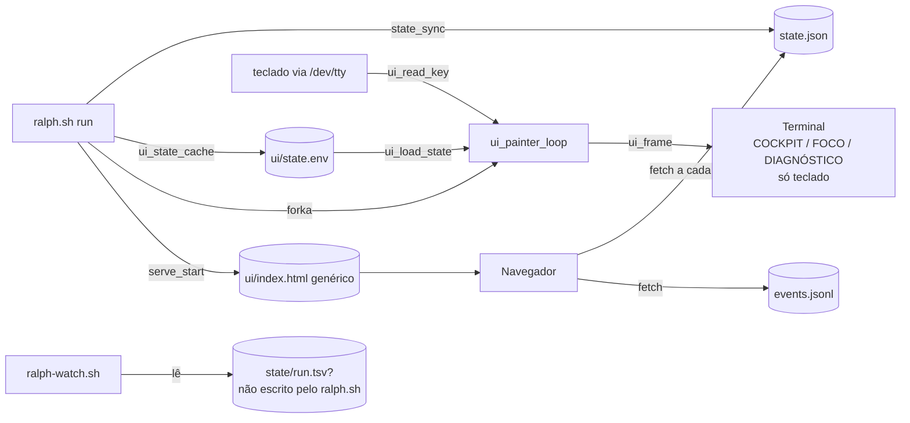
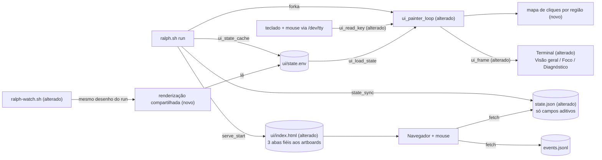

# SPEC: ralph-painel-fiel-artefatos

## Metadata
- Source: developer description via /plan
- Service: bc-harness (`scripts/ralph.sh`, `scripts/ralph-watch.sh`)
- Tier: complete
- Version: 1.1
- Architecture references: `AGENTS.md` (única fonte; `docs/agents/` ausente no checkout — `.gitignore:12` ignora `docs`). Referência visual: `artifacts/ralph-layouts/{01-cockpit.png,02-foco.png,03-diagnostico.png,direcao-visual.md}`; estado atual: `artifacts/ralph-layouts/implementado-*.png`.

Regras de arquitetura citadas (AGENTS.md §2/§3):
- "Observability never changes a verdict: panel, dashboard and notifications are a side-effect layer" — base de RF-12 e RNF-04.
- "`--serve` binds `python3 -m http.server` to `127.0.0.1` and serves ONE static file, `.phases/ui/index.html`" — base de CT-03.
- "`.phases/state.json` ... and `.phases/events.jsonl` ... are a declared PUBLIC contract ... Changing a key is a breaking change" — base de CT-01/CT-02.
- "`scripts/ralph-watch.sh` is a pure reader" — base de RNF-05.
- Bash-only ("The only executable code is bash") e "a new behavior needs a new named case in `scripts/test-ralph.sh`, proven red first via `RALPH_BIN`" — base de RNF-02 e da nota de planejamento em FLEXIBLE.

## Context

O painel do `ralph.sh` já tem três telas (COCKPIT, FOCO, DIAGNÓSTICO) selecionáveis por teclado, mas o resultado (`implementado-*.png`) diverge dos artefatos de direção visual: o cabeçalho é texto corrido em três linhas, a barra de progresso é `#`/`.`, a Visão geral carrega uma tabela FASES E TASKS que o artefato 01 não tem, a aba se chama "1 Cockpit" (o artefato diz "1 Visão geral") e não existe "q Sair" no painel do run. Não há suporte a mouse em nenhuma superfície.

Achados no código:
- O painel do run é pintado por `ui_painter_loop` (verified at scripts/ralph.sh:2333) via `ui_frame` (verified at scripts/ralph.sh:2139); teclas por `ui_read_key` (verified at scripts/ralph.sh:2218) e `ui_apply_key` (verified at scripts/ralph.sh:2248). O `ui_apply_key` trata `1/2/3`, setas, `j/k`, PgUp/PgDn, `g/G`, `a/f` — não trata `q`.
- O teclado só é lido com `RALPH_UI_KEYS=1` e `/dev/tty` legível; caso contrário `UI_KEYS=0` (verified at scripts/ralph.sh:2323-2327). Intervalo de frame default 0,5 s (verified at scripts/ralph.sh:2311).
- O dashboard (`--serve`) é um HTML genérico gerado por `write_dashboard_html` (verified at scripts/ralph.sh:2546), que lê `../state.json` e `../events.jsonl` a cada 1,5 s (verified at scripts/ralph.sh:2677, :2728, :2751). Não tem abas, nem cliques, nem a paleta dos artefatos.
- **`ralph-watch.sh` lê `.phases/state/run.tsv` e `live.tsv` (verified at scripts/ralph-watch.sh:84-86), arquivos que o `ralph.sh` atual não escreve** (Grep por `run.tsv` em `scripts/ralph.sh`: zero ocorrências). O cabeçalho do watch ainda cita `ralph.sh --dashboard` (scripts/ralph-watch.sh:10), flag inexistente no `ralph.sh`. Hoje o watch não mostra o mesmo painel do run; o caminho que funciona é `ralph.sh --attach` (verified at scripts/ralph.sh:284, :607).
- No watch standalone, `q` sai do painel sem interromper o ralph (verified at scripts/ralph-watch.sh:843).
- `state.json` não carrega `failure_gate`, `test_log`, `test_scope`, lista de tasks nem subtítulo de task; parte disso existe só no cache privado `.phases/ui/state.env` (`ui_state_cache`, verified at scripts/ralph.sh:906) e em `.phases/ui/tasks.txt`.

Tokens visuais medidos nos artefatos (amostragem de pixel dos PNGs, 2880×2000):

| Token | Hex | Uso no artefato |
|---|---|---|
| fundo do painel | `#0b1018` | área interna do terminal |
| fundo de caixa | `#101923` | Em andamento, Validação, Tarefas da fase, Tentativa anterior |
| borda / régua / segmento vazio | `#283545` | molduras, separadores, barra pendente |
| aba ativa | `#233b48` | fundo da aba selecionada |
| texto principal | `#dce6ef` | títulos e valores |
| texto secundário | `#91a3b5` | rótulos, "aguardando" |
| ciano (atividade) | `#66d9e8` | RALPH, status IMPLEMENTANDO, tarefa ativa |
| verde (confirmado) | `#8cdeb0` | fases concluídas, segmentos cheios, verificadas |
| âmbar (correção) | `#f3c879` | CORRIGINDO, CICLO, correção atual |
| vermelho (falha) | `#ff8d94` | banner de gate, FAIL |
| fundo do banner de falha | `#291c25` | faixa G2 / TESTES FALHARAM |

## AS IS — Estado atual

Hoje o painel do run é pintado a partir do cache `ui/state.env` e responde só a teclado; o `ralph-watch.sh` lê um contrato TSV que o `ralph.sh` não produz mais, e o dashboard web é um HTML genérico sem abas nem cliques.

## TO BE — Estado proposto

O desenho do terminal passa a reproduzir as regiões dos artboards (UI-01, UI-02, UI-03) e a aceitar clique e roda do mouse (RF-01 a RF-05, RF-07, RF-08 via `NEW_Hit`); o `ralph-watch.sh` usa a mesma renderização do run sobre o mesmo estado (RF-09); o dashboard ganha as três abas fiéis (UI-04 a UI-06, RF-10) e o `state.json` só recebe campos novos, nunca troca os existentes (CT-01).

## Scope
- **In**:
  - Terminal do run (`./ralph.sh` com painel ativo), `ralph.sh --attach` e `./ralph-watch.sh`: três telas com as regiões e a ordem dos artboards 01/02/03.
  - Dashboard `--serve`: as mesmas três telas, fiéis aos artboards em fonte, tamanho, cor e espaçamento.
  - Mouse nas duas superfícies: clique em aba, em "f Seguir", em "q Sair" (só no terminal), em fase e em tarefa; roda do mouse rolando lista.
  - Restauração do terminal (mouse desligado, cursor, buffer, stty) em toda saída.
- **Out**:
  - A moldura de apresentação dos artboards (título "01 Cockpit", subtítulo, rodapé "PROPOSTA VISUAL / DADOS ILUSTRATIVOS", barra de janela com os três círculos e "144 × 40") — decidido em M4.
  - Botão ou ação "Sair" no dashboard do navegador (M1).
  - Histórico novo de tarefas por fase: fase passada/futura clicada mostra tarefas derivadas do plano (M6).
  - A tabela FASES E TASKS da Visão geral atual: o artboard 01 não a tem e o AC 1 fixa as regiões do 01 (remoção coberta por AC confirmado).
  - Qualquer mudança em gate, ciclo, commit, repair, rescue ou exit code.
  - Tema claro, responsividade mobile do dashboard, abertura automática do navegador.
  - Placar em linha corrida (sem TTY / `--no-ui`): permanece idêntico ao de hoje.

## RIGID (Non-Negotiable)

### Decisões de reversibilidade (antecipadas)

| Decisão | Resolução |
|---|---|
| Visão geral perde a tabela FASES E TASKS | Coberta pelo AC 1 (regiões = artboard 01) |
| Nome da aba 1 | "Visão geral" (AC 1), substitui "Cockpit" |
| Mouse segue o mesmo interruptor do teclado (`RALPH_UI_KEYS` + `/dev/tty`) | Coberta pelo AC 7 e pelo comportamento atual (scripts/ralph.sh:2323-2327); confirmado pelo desenvolvedor. Com mouse ativo, copiar texto do terminal exige Shift+arrastar — documentar no `--help` e nos READMEs |
| Clique em fase/tarefa suspende o "seguir"; "f Seguir" retoma | Coberta pelos AC 5/6 e pela semântica atual de `f` (scripts/ralph.sh:2248, ramo `a|A|f|F`) |
| Contrato `state.json`/`events.jsonl`: só aditivo | Regra do AGENTS.md; campos novos aditivos publicados (M3, CT-01) |
| "q Sair" no run ao vivo: fechar painel vs abortar run | Fecha só o painel; o run segue em placar corrido; painel reabrível via `--attach`; navegador sem "Sair" (M1, RF-03) |
| Terminal menor que o layout | Adapta entre 100×24 e 144×40 com ordem de corte fixa; abaixo de 100×24 aviso "aumente para 100×24" (M2, RF-15) |
| Dado mostrado pelo artboard que o estado não carrega | Campos aditivos novos no estado do run, fonte única para terminal e navegador (M3, RF-14) |
| Diagnóstico sem gate falho | Faixa verde "● Nenhum gate falhou", layout estável, campos vazios com "—" (M3b, RF-16) |
| Definição mensurável de "pixel-fiel" | Viewport 1440×1000, sem moldura, tokens medidos exatos, DejaVu Sans Mono embutida (M4, UI-04..06) |
| Fase passada/futura clicada | Tarefas derivadas do plano da fase; sem histórico novo (M6, RF-05) |

### Functional Requirements

- RF-01 [Event-Driven]: Quando o usuário clica no rótulo de uma aba ("1 Visão geral", "2 Foco", "3 Diagnóstico") na barra de abas, o painel (terminal e navegador) deve passar a exibir a tela correspondente e marcar aquela aba como ativa. As teclas `1`, `2`, `3` continuam produzindo o mesmo efeito.
  - AC: clicar em "2 Foco" com a Visão geral ativa faz o próximo frame exibir a tela Foco com a aba "2 Foco" sobre o fundo de aba ativa; o mesmo vale para as outras duas abas, nas duas superfícies.

- RF-02 [Event-Driven]: Quando o usuário clica em "f Seguir" (ou pressiona `f`), o painel deve voltar ao modo automático: a tela passa a acompanhar a fase corrente e a tarefa ativa do run, desfazendo qualquer seleção manual (RF-05) e rolagem manual (RF-04).
  - AC: após selecionar a fase 01 por clique durante a execução da fase 03, clicar em "f Seguir" faz a tela Foco voltar a mostrar "FASE 03 / NN" e a tarefa ativa da fase 03.

- RF-03 [Event-Driven]: Quando o usuário clica em "q Sair" (ou pressiona `q`) no terminal, o painel deve fechar sem interromper o run. No painel do run ao vivo (`ralph.sh` com painel ativo), o painel é encerrado com o terminal restaurado (RF-08) e o run continua no placar em linha corrida até o fim; o painel pode ser reaberto por `ralph.sh --attach`. No `ralph-watch.sh` standalone e no `--attach`, o comportamento atual é preservado: sair do painel sem interromper o ralph (verified at scripts/ralph-watch.sh:843). O dashboard do navegador não exibe "q Sair" nem ação de saída. RF-12 vale sem exceção: "q Sair" não altera veredito, commit nem exit code.
  - AC: (a) no run ao vivo, pressionar `q` ou clicar em "q Sair" durante a fase N encerra o pintor, restaura o terminal (RF-08), o processo do ralph segue vivo com o mesmo PID, a saída passa a ser o placar corrido e o run termina com o mesmo exit code, vereditos e número de commits de um run idêntico sem `q`; `ralph.sh --attach` em seguida volta a exibir o painel; (b) no `ralph-watch.sh` standalone, clicar em "q Sair" encerra o watch com o terminal restaurado e o ralph segue vivo com o mesmo PID; (c) a página do navegador não contém elemento "Sair".

- RF-04 [Event-Driven]: Quando o usuário gira a roda do mouse com o ponteiro sobre uma lista (Últimos eventos, Tarefas da fase, Linha do tempo, Saída do teste), essa lista deve rolar uma linha por passo da roda na direção do giro; o modo de acompanhamento passa a manual até RF-02. Roda com o ponteiro fora de lista não altera nada.
  - AC: com 12 tarefas na fase e 5 visíveis em "Tarefas da fase", um passo de roda para baixo sobre a lista faz a primeira tarefa visível passar de 01 para 02; o mesmo passo com o ponteiro sobre o cabeçalho não altera nenhuma região.

- RF-05 [Event-Driven]: Quando o usuário clica numa fase da jornada (Visão geral) ou numa tarefa (linha "▶ Tarefa N" da caixa Em andamento, ou item de "Tarefas da fase"), o painel deve abrir a tela Foco com aquela fase/tarefa selecionada: cabeçalho "FASE NN / NN" da fase clicada, a tarefa clicada no destaque principal e marcada na lista, e o modo de acompanhamento suspenso até RF-02.
  - Tarefas de fase não corrente (M6): a lista "Tarefas da fase" de uma fase clicada que não é a corrente é derivada do plano daquela fase (a lista de tarefas declarada no arquivo de fases); fase concluída mostra todas as tarefas como `verificada`, fase futura mostra todas como `pendente`. Nenhum histórico novo de tarefas por fase é gravado.
  - AC: durante a fase 03, clicar em "✓ 01 Setup" na jornada abre a tela Foco com "FASE 01 / 06" e a lista "Tarefas da fase" da fase 01 com todas as tarefas do plano da fase 01 marcadas `verificada`; clicar em "· 05 <título>" mostra as tarefas do plano da fase 05 todas `pendente`; o próximo frame do run (que continua na fase 03) não troca a seleção.

- RF-06 [State-Driven]: Enquanto o teclado estiver ativo, o painel deve manter todas as teclas de hoje com o mesmo efeito: `1/2/3`, `↑/↓`, `j/k`, PgUp/PgDn, espaço, `g/G`, Home/End, `a/f` (verified at scripts/ralph.sh:2248-2292), além de `q` conforme RF-03.
  - AC: cada tecla da lista produz, na tela equivalente, o mesmo efeito que produzia antes da feature.

- RF-07 [Conditional]: Se a saída não é TTY, ou o teclado está desligado (`RALPH_UI_KEYS=0`), ou `/dev/tty` não é legível, então o ralph e o `ralph-watch.sh` não devem emitir nenhuma sequência de ativação de relato de mouse (DECSET 1000, 1002, 1003, 1006 ou 1015) e devem manter o comportamento atual (placar corrido sem TTY; painel sem entrada com teclado desligado).
  - AC: a saída capturada de um run com stdout redirecionado para arquivo não contém `ESC[?1000h`, `ESC[?1002h`, `ESC[?1003h`, `ESC[?1006h` nem `ESC[?1015h`, e o placar é idêntico ao produzido antes da feature para o mesmo roteiro.

- RF-08 [Event-Driven]: Quando o painel termina por qualquer caminho — fim normal do run, `ui_stop` antes de saída longa, Ctrl-C/SIGINT, SIGTERM, "q Sair", morte do pintor, fim do `ralph-watch.sh` — o terminal deve ficar com o relato de mouse desligado, cursor visível, buffer principal restaurado, atributos SGR zerados e modo do tty (`stty`) igual ao de antes do painel, antes de qualquer saída longa (relatório final, causa de gate vermelho).
  - AC: em cada caminho listado, a saída termina com as sequências de desativação de mouse emitidas antes de `ESC[?1049l`, e `stty -g` depois da saída é igual ao valor capturado antes do painel; cliques feitos depois da saída não imprimem sequência de escape no shell.

- RF-09 [Ubiquitous]: O `ralph-watch.sh` deve exibir o mesmo painel do run (mesmas três telas, regiões, textos e cores) a partir do estado que o `ralph.sh` efetivamente escreve em `.phases/`, com as mesmas interações de RF-01 a RF-06.
  - AC: para o mesmo diretório `.phases/`, mesma largura, altura e aba, o frame do `ralph-watch.sh --once` é idêntico, byte a byte após remover as sequências ANSI, ao frame do painel do run; com um run ativo, o watch mostra a fase e o ciclo correntes (hoje ele lê `.phases/state/run.tsv`, que não existe).

- RF-10 [Ubiquitous]: O dashboard `--serve` deve ler exclusivamente o estado do próprio run servido de `.phases/` (`state.json` e `events.jsonl`, incluindo os campos aditivos de RF-14), e exibir, para o mesmo instante de estado, os mesmos valores do painel de terminal.
  - AC: para um `state.json` fixo, os valores de fase, ciclo, status, gates, contagens e percentual exibidos no navegador são iguais aos do frame de terminal da mesma aba; a página não faz requisição a nenhuma origem diferente de `127.0.0.1:<porta>`.

- RF-11 [Unwanted]: Se chegar uma sequência de mouse incompleta, desconhecida ou fora de qualquer região clicável, então o painel deve ignorá-la sem imprimir lixo na tela, sem travar a rolagem e sem encerrar o pintor.
  - AC: injetar no tty uma sequência de mouse truncada seguida de `↓` resulta em rolagem de uma linha e em frame sem caracteres da sequência truncada.

- RF-12 [Unwanted]: Se o painel, o mouse, o `ralph-watch.sh` ou o dashboard falharem (erro de desenho, pintor morto, navegador fechado, python3 ausente), então o veredito de cada gate, o número de commits e o exit code do run devem ser os mesmos de um run idêntico sem painel.
  - AC: o mesmo roteiro de mock executado com `--ui` + cliques simulados e com `--no-ui` produz o mesmo exit code, os mesmos vereditos por gate em `events.jsonl` e o mesmo número de commits.

- RF-13 [Ubiquitous]: O `index.html` servido deve ser sempre o escrito pelo `ralph.sh` em execução no início deste run; nenhum HTML de run anterior pode ser servido.
  - AC: iniciar `--serve` com um `.phases/ui/index.html` antigo no disco resulta em página com o layout das três abas desta feature.

- RF-14 [Ubiquitous]: O `ralph.sh` deve publicar no estado do run (`state.json` e, quando for evento, `events.jsonl`), como campos novos aditivos (CT-01, CT-02), todo dado que os artboards mostram e o estado hoje não carrega: gate que falhou, escopo executado e arquivo de teste, manchete da falha e linha `FAIL <nome>` com a mensagem (extraídas pelo `ralph.sh` do log do teste), caminho do log do teste, lista de tarefas da fase com estado, subtítulo da tarefa, título da correção atual e gates da tentativa anterior. Terminal (run, attach, watch) e navegador leem essa mesma fonte; nenhuma chave existente muda.
  - Campo sem valor (padrão derivado da decisão sobre o Diagnóstico sem falha): em todas as telas (Visão geral, Foco, Diagnóstico) e nas duas superfícies, um campo sem valor aparece como "—" na mesma posição, e a região mantém o layout. Única exceção: tarefa sem subtítulo deixa a linha do subtítulo em branco, sem "—".
  - AC (campo vazio): com fixture em que cada campo novo está vazio, cada tela mostra "—" no lugar de cada campo sem valor, com as mesmas regiões e posições da fixture completa, no terminal e no navegador; com uma tarefa sem subtítulo, a linha abaixo do título da tarefa na tela Foco fica em branco e não contém "—".
  - AC: com uma fixture de falha no gate 2 cujo log contém uma linha `FAIL`, o `state.json` resultante contém os campos novos preenchidos com a manchete e a linha `FAIL` extraídas do log, todas as chaves listadas em CT-01 permanecem com o mesmo nome, tipo e valor de um run sem a feature, `schema` continua `1`, e os valores exibidos nas telas Foco e Diagnóstico são iguais no terminal e no navegador.

- RF-15 [Conditional]: Se o terminal tiver menos de 144 colunas ou 40 linhas, o painel deve adaptar o layout: entre 100×24 e 144×40, as caixas lado a lado passam a ser empilhadas e, quando a altura não comporta todas as regiões, as regiões caem nesta ordem: primeiro "Últimos eventos" (Visão geral), depois "Linha do tempo" e "Saída do teste" (Diagnóstico); as demais regiões permanecem. Abaixo de 100 colunas ou 24 linhas, o painel exibe apenas o aviso "aumente para 100×24" no lugar das telas, e o run segue normalmente.
  - AC: (a) em 144×40 as caixas ficam lado a lado e todas as regiões aparecem; (b) em 120×40 as caixas lado a lado aparecem empilhadas e nenhuma região some; (c) em 100×24 a Visão geral omite "Últimos eventos" antes de qualquer outra região e o Diagnóstico omite "Linha do tempo" e "Saída do teste" antes de qualquer outra região; (d) em 99×24 e em 100×23 o frame contém "aumente para 100×24" e nenhuma região das telas; (e) em todos os casos o exit code e os vereditos são os mesmos de um run sem painel.

- RF-16 [State-Driven]: Enquanto nenhum gate tiver falhado no run, a aba "3 Diagnóstico" (terminal e navegador) deve exibir, no lugar do banner vermelho, uma faixa verde "● Nenhum gate falhou"; a "Linha do tempo" continua exibida; cada campo sem valor (tentativa anterior, correção atual, saída do teste) mostra "—"; o layout mantém as mesmas regiões e posições da tela com falha.
  - AC: com fixture de run sem falha, a captura da aba Diagnóstico contém "● Nenhum gate falhou" em verde, não contém "FALHARAM", contém a Linha do tempo, mostra "—" em cada campo vazio e tem as mesmas 8 regiões na mesma ordem de UI-03, nas duas superfícies.

### UI Requirements

Superfícies ("rota") de cada tela:
- Terminal do run: `./ralph.sh --ui <PHASES.md>` (ou default `auto` em TTY), aba correspondente.
- Terminal do watch: `./ralph-watch.sh [repo]`, aba correspondente (RF-09).
- Navegador: `http://127.0.0.1:<porta>/ui/` (verified at scripts/ralph.sh:2529), aba correspondente.

Regra de adaptação do terminal (limite confirmado): o terminal não tem tamanho de fonte — todo texto que no artboard é maior (RALPH, valores das métricas, título da fase, título da tarefa, manchete do banner) vira **negrito + cor do artboard**; caixas e banner usam **fundo de célula** com a cor do artboard; aba ativa usa fundo de célula `#233b48`. Toda cor vem acompanhada de símbolo ou palavra (`✓ ▶ ● × ·`, "aguardando", "detectado"), conforme `direcao-visual.md`.

- UI-01 [State-Driven]: Enquanto a aba "1 Visão geral" estiver ativa no terminal, o painel deve exibir, de cima para baixo, as regiões do artboard `.spec/features/ralph-painel-fiel-artefatos/artboards/01-visao-geral.png`:
  1. Cabeçalho: `RALPH` (negrito ciano) · nome do projeto · engine em maiúsculas (secundário) · `● <STATUS>` à direita (ponto + palavra na cor do status: ciano em execução, âmbar em correção, verde concluído, vermelho falha); régua `#283545` abaixo.
  2. Quatro métricas lado a lado, rótulo em maiúsculas secundário e valor negrito: `TEMPO TOTAL` (`18m 42s`), `FASES CONCLUÍDAS` (`NN / NN`), `CICLO ATUAL` (`NN / NN`), `PROGRESSO / FASES` (`NN%`, inteiro truncado de concluídas ÷ total × 100).
  3. Barra segmentada: segmentos cheios verdes proporcionais ao percentual, restantes `#283545`.
  4. Jornada: uma entrada por fase `✓ NN Título` (verde, concluída), `▶ NN Título` (ciano negrito, corrente), `· NN Título` (secundário, pendente).
  5. Duas caixas lado a lado com fundo `#101923`: "EM ANDAMENTO / FASE NN" (título da fase negrito, `▶ Tarefa N: <título>` ciano, `X verificadas / Y ativa / Z pendentes`, `› <atividade>`) e "VALIDAÇÃO DA FASE" (quatro linhas `G0 Sessão`, `G1 Código`, `G2 Testes`, `G3 Verificação` com a palavra de estado à direita na cor semântica).
  6. "ÚLTIMOS EVENTOS": linhas `HH:MM:SS  <frase>`, frase na cor semântica do evento.
  7. Régua e barra de abas: `1 Visão geral`, `2 Foco`, `3 Diagnóstico` à esquerda (ativa com fundo `#233b48` e texto ciano negrito), `f Seguir` e `q Sair` à direita.
  - AC: com um estado de fixture equivalente aos dados do artboard 01 em terminal 144×40, a captura do terminal mostra as 7 regiões nesta ordem, com os mesmos textos visíveis do artboard para os mesmos dados e sem a tabela FASES E TASKS; nenhuma região do artboard está ausente.

- UI-02 [State-Driven]: Enquanto a aba "2 Foco" estiver ativa no terminal, o painel deve exibir as regiões do artboard `.spec/features/ralph-painel-fiel-artefatos/artboards/02-foco.png`:
  1. Cabeçalho idêntico ao da UI-01.
  2. Linha `FASE NN / NN` (ciano negrito) · título da fase · `TOTAL XmYs` à direita.
  3. Destaque da tarefa corrente (ou selecionada, RF-05) com faixa vertical ciano à esquerda: `TAREFA NN / NN · <ESTADO>`, título da tarefa em negrito, subtítulo secundário (RF-14), `› Editando <arquivo>` ciano.
  4. "CONFIRMAÇÃO INDEPENDENTE": `X de Y tarefas verificadas` (verde) e a linha `Atividade da sessão ≠ tarefa concluída` (secundário).
  5. Caixa "TAREFAS DA FASE" à direita, fundo `#101923`: por tarefa, `NN  Título` e, abaixo, a palavra de estado (`verificada` verde, `em andamento` ciano, `pendente` secundário); tarefa corrente/selecionada em ciano.
  6. Pipeline `IMPLEMENTAÇÃO → TESTES → VERIFICAÇÃO → COMMIT`, etapa ativa entre colchetes `[ ... ]` em ciano negrito, demais secundárias.
  7. Linha de ciclo: `Ciclo N/M` e `Próximo: <próxima etapa>`.
  8. Barra de abas da UI-01 com "2 Foco" ativa.
  - AC: com fixture equivalente ao artboard 02 em 144×40, a captura mostra as 8 regiões nesta ordem, com a tarefa corrente destacada na caixa e no destaque principal.

- UI-03 [State-Driven]: Enquanto a aba "3 Diagnóstico" estiver ativa no terminal, o painel deve exibir as regiões do artboard `.spec/features/ralph-painel-fiel-artefatos/artboards/03-diagnostico.png`:
  1. Cabeçalho idêntico ao da UI-01 (status `● CORRIGINDO` em âmbar durante correção).
  2. Linha `FASE NN / NN  <título>` e `CICLO NN / NN` à direita em âmbar negrito.
  3. Banner do gate que falhou: faixa vertical vermelha, fundo `#291c25`, `GN / <GATE> FALHARAM` (vermelho), manchete negrito, `Escopo executado: <escopo> · <arquivo>` secundário.
  4. Caixa "TENTATIVA ANTERIOR": uma linha por gate com símbolo e cor (`✓` verde, `●` ciano, `×` vermelho, `·` secundário) e frase.
  5. Caixa "CORREÇÃO ATUAL": `▶ <correção>` âmbar negrito, `Atividade: <atividade>`, `Depois: reavaliar os gates` secundário.
  6. "LINHA DO TEMPO": `HH:MM:SS  <frase>` na cor semântica.
  7. Caixa "SAÍDA DO TESTE": `FAIL  <nome>` vermelho, mensagem, `Log: .phases/logs/<arquivo>` secundário.
  8. Barra de abas da UI-01 com "3 Diagnóstico" ativa.
  - AC: com fixture de falha no gate 2 equivalente ao artboard 03 em 144×40, a captura mostra as 8 regiões nesta ordem; o estado sem falha registrada segue RF-16.

Critério de fidelidade do navegador (M4): viewport de referência 1440×1000 (os artboards 2880×2000 em escala 2x); a moldura de apresentação dos artboards fica fora do escopo — só o painel interno é reproduzido; cores, tamanhos de fonte e espaçamentos iguais aos valores medidos no artboard (tabela de tokens do Context para cores); fonte DejaVu Sans Mono embutida na própria página (acréscimo aproximado de 300 KB, sem acesso externo, CT-03); verificação por comparação lado a lado da captura com o artboard, sem ferramenta nova.

- UI-04 [State-Driven]: Enquanto a aba "1 Visão geral" estiver ativa no navegador (`http://127.0.0.1:<porta>/ui/`), o dashboard deve reproduzir o painel interno do artboard `01-visao-geral.png` — mesmas regiões de UI-01, em DejaVu Sans Mono embutida, com tamanhos, cores e espaçamentos iguais aos medidos no artboard.
  - AC: a captura do navegador em viewport 1440×1000 sobre fixture equivalente ao artboard 01, lado a lado com o painel interno do artboard, tem todas as regiões de UI-01 na mesma posição relativa, toda cor igual a um hex da tabela de tokens, tamanhos de fonte e espaçamentos iguais aos medidos no artboard, fonte DejaVu Sans Mono carregada da própria página e nenhuma requisição fora de `127.0.0.1:<porta>`.

- UI-05 [State-Driven]: Idem UI-04 para a aba "2 Foco" contra `02-foco.png`, com as regiões de UI-02.
  - AC: mesmo critério de UI-04 contra `02-foco.png`.

- UI-06 [State-Driven]: Idem UI-04 para a aba "3 Diagnóstico" contra `03-diagnostico.png`, com as regiões de UI-03.
  - AC: mesmo critério de UI-04 contra `03-diagnostico.png`.

- UI-07 [Event-Driven]: Quando o ponteiro está sobre um elemento clicável no navegador (aba, Seguir, fase, tarefa), o cursor deve ser o de ponteiro (mão); no terminal nenhum realce de hover é exigido.
  - AC: no navegador, o cursor sobre cada elemento clicável listado é `pointer`; sobre texto não clicável, não é.

### Contracts

- CT-01 `state.json` (contrato público, AGENTS.md §2): todas as chaves existentes (`schema`, `project`, `engine`, `input`, `test_cmd`, `started_at`, `updated_at`, `run_status`, `phase{...}`, `gates{...}`, `repair{...}`, `rescue{...}`, `limit{...}`, `progress_line`, `activity`, `last_error`, `pid`, `run_id`, `phases[]` — verified at scripts/ralph.sh:845-897) mantêm nome, tipo e semântica. Os dados novos exigidos pelas telas (RF-14) entram como chaves novas, sem remover nem renomear chave; `schema` continua `1`.
- CT-02 `events.jsonl`: formato de linha e eventos existentes inalterados (verified at scripts/ralph.sh:1113); eventos novos, se houver, só aditivos.
- CT-03 Dashboard: servido em `http://127.0.0.1:<porta>/ui/` (verified at scripts/ralph.sh:2529), bind exclusivo em `127.0.0.1` (verified at scripts/ralph.sh:2526), página auto-contida — sem CDN, sem fonte remota, sem fetch externo (verified at scripts/ralph.sh:2544-2545); só busca arquivos sob `.phases/` do próprio run.
- CT-04 Mapa de entrada (terminal e navegador):

  | Alvo | Clique | Tecla | Efeito |
  |---|---|---|---|
  | aba 1/2/3 | sim | `1`/`2`/`3` | RF-01 |
  | f Seguir | sim | `f`/`a` | RF-02 |
  | q Sair (só terminal) | sim | `q` | RF-03 |
  | fase da jornada | sim | — | RF-05 |
  | tarefa (Em andamento / Tarefas da fase) | sim | — | RF-05 |
  | lista sob o ponteiro | roda | `↑/↓ j/k PgUp/PgDn g/G` | RF-04 / RF-06 |

### Non-Functional Requirements

- RNF-01: Um clique ou tecla no terminal deve produzir o frame correspondente em no máximo um intervalo de frame (default 0,5 s, verified at scripts/ralph.sh:2311, ajustável por `RALPH_UI_FPS`). No navegador, a troca de aba e a seleção por clique não esperam o ciclo de leitura de estado de 1,5 s (verified at scripts/ralph.sh:2751).
- RNF-02: Nenhuma dependência nova obrigatória: terminal em bash puro; dashboard sem CDN/fonte remota; `python3` continua opcional (ausente = aviso e run segue).
- RNF-03: Cor nunca é o único portador de significado — todo estado colorido tem símbolo ou palavra (`direcao-visual.md`).
- RNF-04: Painel, mouse, watch e dashboard são camada de efeito colateral: não alteram veredito de gate, commit nem exit code (AGENTS.md §2; AC 9).
- RNF-05: `ralph-watch.sh` e `ralph.sh --attach` permanecem leitores puros: não criam, truncam nem alteram nenhum arquivo em `.phases/` exceto os próprios arquivos de viewport/inferência já previstos para o attach (verified at scripts/ralph.sh:637, :644).
- RNF-06: O painel não pode deixar pintor vivo depois de `ui_stop` (invariante atual, verified at scripts/ralph.sh:2441-2459) — o mouse não introduz novo processo sobrevivente.

### Decisões resolvidas (v1.1)

- M1 — "q Sair" fecha só o painel; o run segue em placar corrido; reabrível via `--attach`; navegador sem "Sair"; RF-12 sem exceção. Aplicado em RF-03, CT-04, UI-07.
- M2 — Adaptação entre 100×24 e 144×40 (caixas empilham; cortes: Últimos eventos, depois Linha do tempo e Saída do teste); abaixo de 100×24, aviso "aumente para 100×24". Aplicado em RF-15.
- M3 — Campos novos aditivos no estado do run; manchete e linha FAIL extraídas do log do teste pelo `ralph.sh`; fonte única para terminal e navegador. Aplicado em RF-10, RF-14, CT-01.
- M3b — Diagnóstico sem falha: faixa verde "● Nenhum gate falhou", Linha do tempo mantida, "—" em campo vazio, layout estável. Aplicado em RF-16, UI-03.
- M3c (padrão derivado de M3b) — Em todas as telas e nas duas superfícies, campo sem valor = "—" na mesma posição, layout mantido; exceção: tarefa sem subtítulo deixa a linha em branco. Aplicado em RF-14.
- M4 — Viewport 1440×1000, moldura fora, valores medidos exatos, DejaVu Sans Mono embutida (~+300 KB), comparação lado a lado sem ferramenta nova. Aplicado em UI-04..06, Scope.
- M6 — Fase não corrente clicada: tarefas derivadas do plano; concluída = todas `verificada`, futura = todas `pendente`; sem histórico novo. Aplicado em RF-05.
- Mouse segue o interruptor do teclado; copiar texto com mouse ativo = Shift+arrastar (documentar). Aplicado na tabela de reversibilidade.

## FLEXIBLE (Implementation Suggestions)

- Mouse no terminal: ligar `ESC[?1000h` + `ESC[?1006h` (SGR) em `ui_start` só quando `UI_KEYS=1`; desligar com `ESC[?1006l ESC[?1000l` em `ui_stop`, `cleanup_ui` (scripts/ralph.sh:2768) e `on_interrupt` (:2780), antes de `ESC[?1049l`. Parse em `ui_read_key`: CSI `<` b ; x ; y `M|m`; botões 64/65 = roda.
- Mapa de cliques: `ui_frame` grava, ao lado de `.phases/ui/.viewport`, as regiões clicáveis do último frame (`linha|col_ini|col_fim|ação`); `ui_apply_key` resolve o clique contra esse arquivo — mesmo padrão que o viewport já usa para rolagem.
- Estado de seleção (`UI_SEL_PHASE`, `UI_SEL_TASK`) no pintor, zerado por `f/a`, como `UI_SCROLL=-1` hoje.
- Cores: truecolor (`38;2;r;g;b` / `48;2;r;g;b`) com os hex da tabela de tokens quando `COLORTERM` indicar suporte; fallback para a paleta 256 mais próxima (`UI_C_*`, scripts/ralph.sh:1219-1231).
- `ralph-watch.sh`: em vez de manter um segundo renderizador sobre `run.tsv`, carregar as funções do `ralph.sh` com `RALPH_LIB_ONLY=1` e delegar ao mesmo caminho do `--attach`; remover a referência a `--dashboard`.
- Dashboard: reescrever `write_dashboard_html` com CSS custom properties dos tokens, grid com as mesmas regiões, abas em JS local (`hashchange` ou estado em memória), `cursor: pointer` nos clicáveis, `wheel` nas listas com `overflow:auto`.
- Palavras de estado de gate: reusar `ui_gate_words` (scripts/ralph.sh:1941).
- Planejamento (não é AC): comportamentos com ramificação candidatos a caso nomeado em `scripts/test-ralph.sh` — sem mouse escape fora de TTY (estender `ui-non-tty`, :1498), restauração em todos os caminhos de saída (estender `ui-painter-exit`, :2086), clique → troca de tela/seleção (estender `ui-keys`, :1968), watch = run para o mesmo estado, regiões por tela (estender `ui-layouts`, :3223). Verificação visual por comparação de captura com os artboards.

## Acceptance Criteria Summary

| ID | Criterion | Testable? |
|----|-----------|-----------|
| RF-01 | Clique em aba troca a tela e marca a aba ativa, nas duas superfícies; `1/2/3` idem | yes |
| RF-02 | "f Seguir" volta a acompanhar fase/tarefa corrente e desfaz seleção/rolagem | yes |
| RF-03 | "q Sair" fecha só o painel (run segue em placar corrido, reabrível via attach); watch sai sem matar o ralph; navegador sem "Sair" | yes |
| RF-04 | Roda sobre lista rola 1 linha por passo; fora de lista não faz nada | yes |
| RF-05 | Clique em fase/tarefa abre Foco com ela selecionada e suspende o seguir | yes |
| RF-06 | Teclas atuais preservadas com o mesmo efeito | yes |
| RF-07 | Sem TTY/teclado: nenhuma sequência de ativação de mouse; placar inalterado | yes |
| RF-08 | Todo caminho de saída desliga mouse, restaura buffer, cursor, SGR e stty | yes |
| RF-09 | Frame do watch = frame do run para o mesmo estado/tamanho/aba | yes |
| RF-10 | Navegador mostra os mesmos valores do terminal; só origem 127.0.0.1 | yes |
| RF-11 | Sequência de mouse inválida ignorada sem lixo nem travamento | yes |
| RF-12 | Mesmo exit code, vereditos e commits com e sem painel | yes |
| RF-13 | index.html servido é sempre o do run corrente | yes |
| RF-14 | Dados dos artboards publicados como campos aditivos; chaves antigas intactas; mesma fonte nas duas superfícies | yes |
| RF-15 | 100×24..144×40 adapta com ordem de corte fixa; abaixo, aviso "aumente para 100×24" | yes |
| RF-16 | Diagnóstico sem falha: faixa verde, Linha do tempo, "—", layout estável | yes |
| UI-01 | Visão geral no terminal: 7 regiões do artboard 01, em ordem, sem tabela | yes (captura vs artboard) |
| UI-02 | Foco no terminal: 8 regiões do artboard 02, tarefa corrente destacada | yes (captura vs artboard) |
| UI-03 | Diagnóstico no terminal: 8 regiões do artboard 03 | yes (captura vs artboard) |
| UI-04 | Visão geral no navegador fiel ao artboard 01 (1440×1000, valores medidos, fonte embutida) | yes (captura lado a lado) |
| UI-05 | Foco no navegador fiel ao artboard 02 | yes (captura lado a lado) |
| UI-06 | Diagnóstico no navegador fiel ao artboard 03 | yes (captura lado a lado) |
| UI-07 | Cursor `pointer` só nos clicáveis do navegador | yes |
| CT-01 | Chaves existentes do state.json intactas; só adições; schema 1 | yes |
| CT-02 | events.jsonl sem mudança de formato | yes |
| CT-03 | Bind 127.0.0.1, URL `/ui/`, página sem origem externa | yes |
| CT-04 | Mapa clique/tecla → efeito | yes |
| RNF-01 | Resposta em ≤ 1 intervalo de frame; navegador não espera o poll de 1,5 s | yes |
| RNF-02 | Nenhuma dependência obrigatória nova | no (inspeção de código) |
| RNF-03 | Toda cor acompanhada de símbolo/palavra | no (inspeção visual) |
| RNF-04 | Observabilidade não altera veredito/exit code | yes (via RF-12) |
| RNF-05 | watch/attach não escrevem estado do run | yes |
| RNF-06 | Nenhum pintor sobrevive a `ui_stop` | yes |
